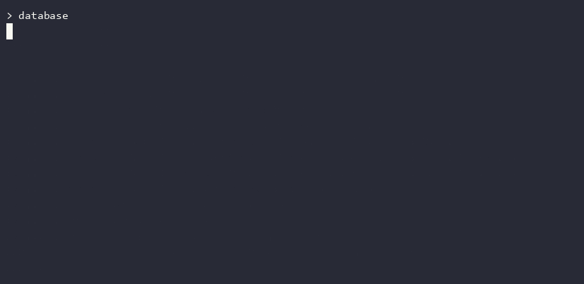

# Primitive Database

Учебная база данных с консольным интерфейсом. Она поддерживает управление
таблицами, добавление, чтение, обновление и удаление записей. Схемы хранятся
в `db_meta.json`, а записи каждой таблицы — в отдельном файле
`data/<таблица>.json`. Файлы создаются в каталоге, из которого запущена программа.

## Установка и запуск

В каталоге проекта, используя Python 3.12:

```console
uv sync --locked
uv run database
uv run ruff check .
```

С Poetry доступны те же команды:

```console
poetry install
poetry run database
poetry run ruff check .
```

В окружении с GNU Make можно использовать `make install`, `make run` и
`make lint`. Команда `uv build` собирает архив исходников и wheel в `dist/`.

## Управление таблицами

- `create_table users name:str age:int is_active:bool` создаёт таблицу.
- `list_tables` показывает имена таблиц.
- `info users` выводит схему и количество записей.
- `drop_table users` удаляет таблицу после подтверждения.
- `help` показывает справку. `exit` завершает работу.

Поддерживаются `int`, `str` и `bool`. Столбец `ID:int` добавляется автоматически.
При вставке обязательны все значения, кроме `ID`. Идентификатор вычисляется как
наибольший текущий ID плюс один. Для первой записи он равен 1.

## CRUD-операции

```sql
insert into users values ("Анна", 28, true)
select from users
select from users where age = 28
update users set age = 29 where name = "Анна"
delete from users where ID = 1
```

Строки заключайте в одинарные или двойные кавычки. Целые числа и логические
значения `true` и `false` вводите без кавычек. `where` проверяет равенство
в одном столбце, а `set` изменяет один столбец во всех подходящих записях.
Результаты выборки выводятся через PrettyTable.

## Декораторы и кэш

Ошибки ввода, неизвестные таблицы и столбцы выводятся в консоль, после чего
можно ввести следующую команду. Для `delete` и `drop_table` ответьте `y`,
чтобы продолжить, или введите другой ответ, чтобы отменить действие.
Для `insert` и `select` программа показывает время выполнения.

Повторный `select` с тем же условием и содержимым таблицы использует кэш
результатов текущего запуска. После изменения строк выборка вычисляется заново.

## Демонстрация

[](https://asciinema.org/a/3S3bFiJ7TuDFT7wk)

Запись показывает создание таблицы, все CRUD-операции, сообщение об ошибке
валидации, отмену и подтверждение удаления. Исходная
[запись asciicast](docs/database-demo.cast) хранится в репозитории.
